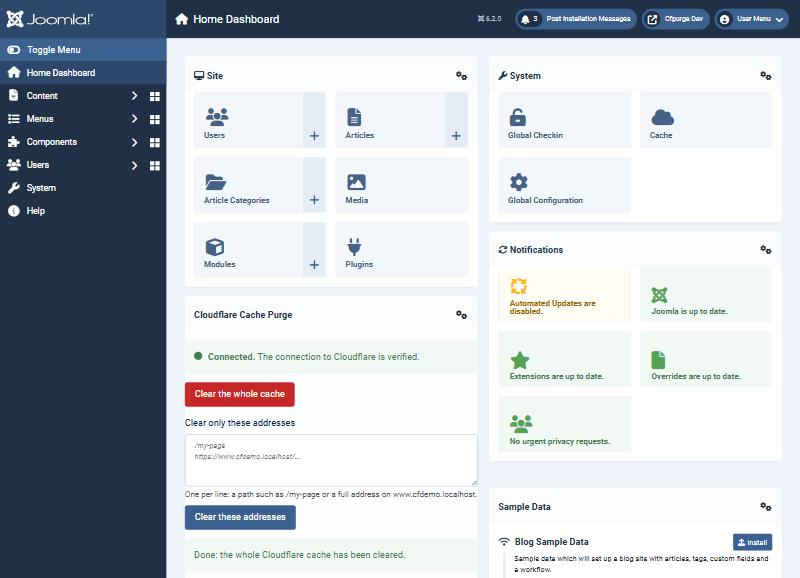

# Cloudflare Cache Purge

Joomla package by [WebG](https://www.webg.it), free software under the GNU GPL v2 or later.
It clears the **Cloudflare cache** when your Joomla site changes, from a box on the administrator
home page when you want to, and through the Joomla API when a program asks.



- **Automatic purge** when an article, a category, a menu item, a site module, a custom field or a
  tag is created, changed, published, unpublished or deleted (each kind has its own switch). Best
  effort: a failed call to Cloudflare never blocks a save, it is logged and shown in the box.
- **Box on the home page**: traffic light of the connection, *Clear the whole cache*, a field to clear
  one or more addresses, outcome of the last purge.
- **Guided setup** with a *Verify connection* button that says in plain words what is wrong.
- **API for programs (2.1)**: a bot can clear the cache with the Joomla API token of a user you allow
  (`GET v1/cfpurge/status`, `POST v1/cfpurge/all`, `POST v1/cfpurge/urls`), with its own permissions
  by user group; the Cloudflare token never leaves the site.
- Optional: *targeted mode* (only the changed addresses) and clearing Cloudflare together with
  *System > Clear Cache*.

**Requirements**: Joomla 5.0 or later (5.x and 6.x; not Joomla 4), PHP 8.1+, a site behind Cloudflare, a
Cloudflare API token limited to *Cache Purge* (kept in the plugin options, never in the code).

**Install**: download `pkg_cfpurge-2.1.1.zip` from the
[releases](https://github.com/WebG-it/cloudflare-cache-purge/releases) (or [dist/](./dist)), then
*System > Install > Extensions > Upload Package File*. Installing over the old plugin 1.1.4 keeps
Zone ID, token and switches. Guides: [user guide](./docs/cfpurge/USAGE.md) ·
[guida in italiano](./docs/cfpurge/USO.md) · [developer guide](./docs/cfpurge/DEVELOPING.en.md).

**Updates**: automatic, in *System > Update > Extensions*. The update server is
[`collection.xml`](./collection.xml) in this repository
(`https://raw.githubusercontent.com/WebG-it/cloudflare-cache-purge/main/collection.xml`), which points to
[`updates/cfpurge.xml`](./updates/cfpurge.xml). The 1.x plugin (up to 1.1.4) declared the shared
collection of [joomla-extensions](https://github.com/WebG-it/joomla-extensions), which still lists this
extension and points here. Versions 2.0.0 and 2.1.0 were built but never published: 2.1.1 is the first release of
the package.

## Repository

```
plugins/pkg_cfpurge/             package source: content, system and Web Services plugins, administrator module, API component
dist/                            installable zips (1.x plugin zips and the package)
collection.xml                   update server (one row)
updates/cfpurge.xml              its details: version, download, sha256
changelogs/cfpurge.xml           changelog feed shown by Joomla
build/release-notes/             text of each GitHub release
docs/cfpurge/                    user guides (USAGE, USO) and developer guides (DEVELOPING)
docs/JED-listing.md              fields for the JED listing
assets/                          logos
```

Build script, Docker test sites (Joomla 5 and 6), the fake Cloudflare API and the end-to-end tests
live in [joomla-dev-tools](https://github.com/WebG-it/joomla-dev-tools): not copied here. A new version
always changes the version number: two different zips never share one.

Support: [GitHub issues](https://github.com/WebG-it/cloudflare-cache-purge/issues) (write your
Joomla and PHP versions; never post passwords, keys or tokens).

License: GNU GPL v2 or later.
