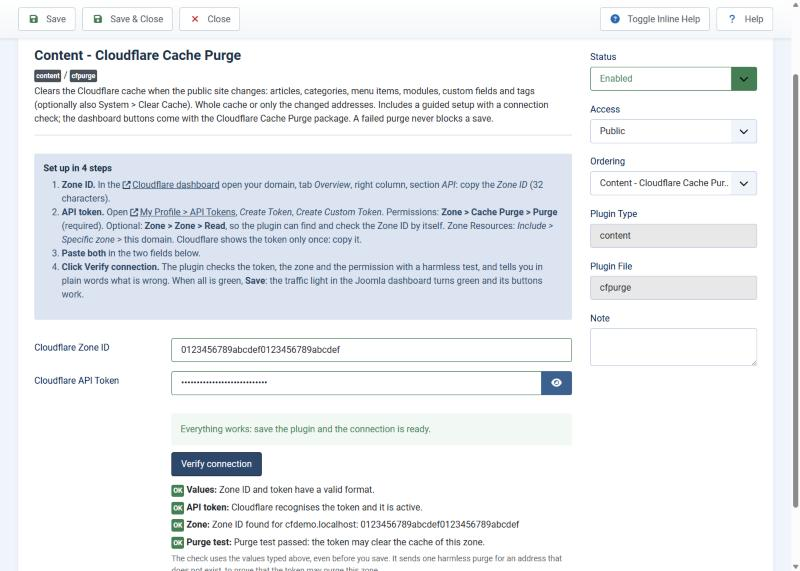
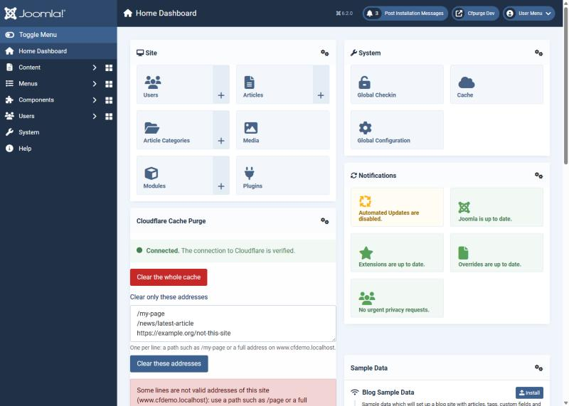

# Cloudflare Cache Purge: user guide

For whoever runs the Joomla site. Everything is done from the Joomla administrator: no code, no
command line. Developers: see [DEVELOPING.en.md](./DEVELOPING.en.md). Italian version:
[USO.md](./USO.md).

In one line: when your site changes, **the Cloudflare cache is cleared automatically**, and a box
on the administrator home page lets you clear it **by hand**, all of it or just some pages.

## 1. What you get

- **Automatic purge** when you create, edit, publish, unpublish, trash or delete an article, and
  also when you change a category, a menu item, a site module, a custom field or a tag. Each kind
  of change has its own switch.
- **Home page box** (administrator dashboard): traffic light of the Cloudflare connection, button
  *Clear the whole cache*, a field to clear one or more addresses, and the outcome of the last
  purge.
- **Guided setup** with a *Verify connection* button that tells you in plain words what is wrong
  (token, permission, Zone ID).
- Optional: clear Cloudflare **together with System > Clear Cache**, and a **targeted mode** that
  clears only the changed pages instead of the whole cache.

Requirements: Joomla 5 or 6, PHP 8.1 or later, a Cloudflare account with your domain in it. Tested
on Joomla 6.2.0 and 5.4.10 with PHP 8.4.

## 2. Install

*System > Install > Extensions > Upload Package File*, drop `pkg_cfpurge-2.0.0.zip`
(from the [releases](https://github.com/WebG-it/joomla-extensions/releases)). The installer
switches everything on and puts the box on the home page.

**If you have the old plugin (1.1.4 or earlier)**: install the package over it, or use *System >
Update > Extensions*. It is an upgrade in place: Zone ID, token and switches stay. Open the plugin
options once and click **Verify connection** (see step 4 below): the buttons of the box stay off
until the saved connection is verified.

## 3. Cloudflare: Zone ID and token

The plugin needs two things from Cloudflare. The plugin options explain them too, at the top.

**Zone ID**
1. Open the [Cloudflare dashboard](https://dash.cloudflare.com) and click your domain.
2. On the **Overview** page, right column, section **API**, copy the **Zone ID** (32 characters).

**API token** (only the permission it needs)
1. Top right, your profile > **My Profile** > **API Tokens** > **Create Token** > **Create
   Custom Token**.
2. Name it, for example `joomla-cache-purge-yourdomain`.
3. Permissions: **Zone > Cache Purge > Purge** (required). Optional: **Zone > Zone > Read**: with it
   the plugin can find the Zone ID by itself and check that it is the one of this site.
4. Zone Resources: **Include > Specific zone** > your domain.
5. **Create Token** and copy it: Cloudflare shows it only once.

## 4. Set up the plugin

*System > Plugins*, open **Content - Cloudflare Cache Purge**. The tab **Plugin** starts with the
four steps. Paste the Zone ID and the token (you can leave the Zone ID empty if the token has
Zone Read) and click **Verify connection**.

It checks the format, asks Cloudflare if the token is active, finds or checks the zone, and
sends one **harmless test purge** (for an address that does not exist) to prove that the token may
purge this zone. When something is wrong it says what, and what to do:

When everything is green click **Save**. The traffic light in the home page turns green.

## 5. The box on the home page

| State | Meaning |
|---|---|
| **Not configured** (grey) | Zone ID or token missing. |
| **Not verified** (yellow) | Both are set but the connection was not verified (or you changed them after). The clear buttons are off. |
| **Not working** (red) | The last check failed. Open the settings and click *Verify connection*. |
| **Connected** (green) | Verified. |
| **Check the last purge** (yellow) | Verified, but the last purge failed: see the line at the bottom. |
| **Plugin off** (grey) | The content plugin is disabled in *System > Plugins*. |

- **Clear the whole cache**: asks for a confirmation, then clears everything.
- **Clear only these addresses**: one per line, either a path (`/my-page`) or a full address of
  the site. Addresses of other sites are refused. Up to 100 at a time.
- **Last purge**: when, who, what, why (an article saved, the dashboard button, ...) and whether
  Cloudflare confirmed it.

Who sees the box: **Super Users** and the user groups chosen in the options (default
Administrator and Super Users). Other backend users do not see it, and the server refuses their
requests even if they craft them.

## 6. Options

**When to clear** tab:

- **What to clear**: *The whole cache* (default, safest) or *Only the changed addresses*. In the
  targeted mode an article clears its own page, the pages of its category and parent categories, the
  home page and the **fixed extra addresses** you list (for example `/sitemap.xml`, `/feed`); when
  an article is renamed or moved its old address is cleared too. Lists that show the article
  elsewhere (side modules, search, pagination, tags, language home pages) are **not** cleared
  and stay until Cloudflare expires them: use the whole cache if that matters. Anything that is
  not an article, and any case where the addresses cannot be worked out, clears the whole cache.
- **Articles**: on creation, update, state change, deletion (switches, all on by default).
- **Other changes to the public site**: categories, menu items, site modules, custom fields and
  tags (on by default, always the whole cache).
- **Clear Cloudflare when I clear the Joomla cache**: *System > Clear Cache*, buttons *Delete* and
  *Delete All* (not *Purge Expired*). Off by default.

**Who can purge** tab: the user groups that see the box and can use its buttons (Super Users
always can). The automatic purge does not depend on this.

## 7. Good to know

- **The purge never blocks a save.** If Cloudflare refuses or is unreachable the article is saved
  anyway; the failure is in the log and in the box. A call to Cloudflare times out after 8 seconds.
- **Several changes in one request are one call** (a batch publish of 50 articles). Cloudflare
  accepts 30 addresses per call: more are sent in blocks, above 90 the whole cache is cleared.
- **The log** is `administrator/logs/plg_content_cfpurge.php`: one line per purge or check, no
  token, no Zone ID, rotated above 1 MB.
- **The token** is stored in the plugin options, like in the old versions, and is sent only to
  `api.cloudflare.com`.
- Changes made directly in the database (not through Joomla) do not raise events: use the box.
- An article that becomes visible **by itself** at its *Start Publishing* date (or disappears at its
  *Finish Publishing* date) raises no event either: clear it by hand, or keep short cache times in
  Cloudflare for pages with scheduled publishing.

## 8. Update and uninstall

Updates appear in *System > Update > Extensions* (the package registers the WebG update server).

*System > Manage > Extensions*, search **Cloudflare Cache Purge**, select the **package** and
**Uninstall**. Everything goes: the plugins, the module and its place on the home page, the
language files, the log and the update server. There are no database tables.

## 9. Troubleshooting

| You see | What to do |
|---|---|
| *The token is empty / does not look right* | Paste the token again, only the token (no spaces, no word Bearer). |
| *Cloudflare refuses the purge (HTTP 403, code 10000)* | The token lacks **Zone > Cache Purge > Purge**, or it is not allowed on this zone. Create a new token as in step 3. |
| *Cloudflare does not know this Zone ID* | Copy it again from the Overview page of the domain. |
| *This Zone ID belongs to the zone X, which does not cover this site* | You pasted the Zone ID of another domain: use the proposed one. |
| *Cloudflare cannot be reached from this server* | The hosting blocks outgoing HTTPS calls to `api.cloudflare.com`. |
| The box is not on the home page | You are not in an allowed group, or the module was unpublished: *System > Administrator Modules*, *Cloudflare Cache Purge*, position `cpanel`. |
| A change is not cleared | Check that the plugin (and, for modules and *Clear Cache*, the system plugin) is enabled, that the switch of that kind of change is on, and read the log. |

## Tested compatibility

Joomla 6.2.0 and 5.4.10, PHP 8.4, MariaDB 11.4: install, upgrade over 1.1.4, update through the update
server, purge from the box, verification with wrong tokens and zones, all the events, targeted
addresses, uninstall. Cloudflare was a fake API (no real token used in the tests). JED Checker
`master` and `develop`: no errors, no warnings.

Support: [GitHub issues](https://github.com/WebG-it/joomla-extensions/issues) (write your Joomla
and PHP versions; never post tokens or private data).
