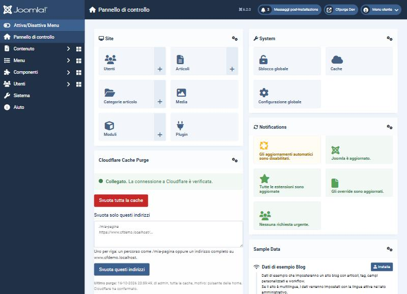
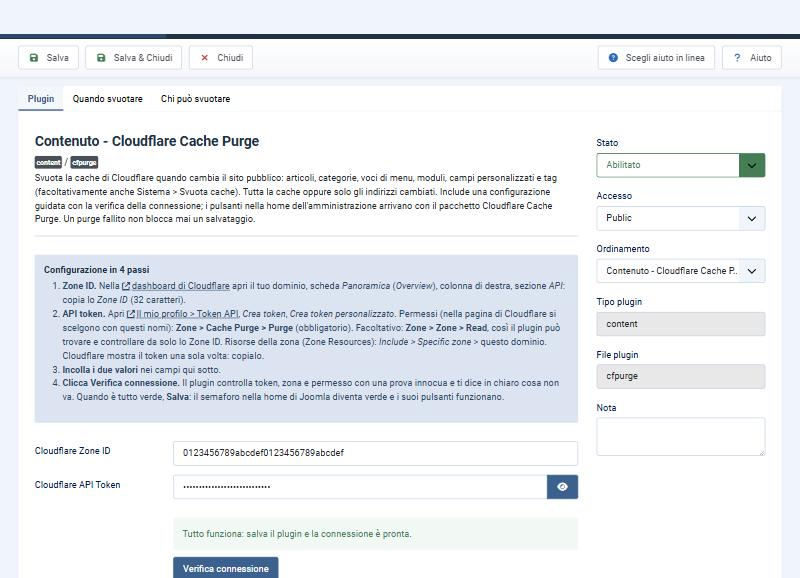
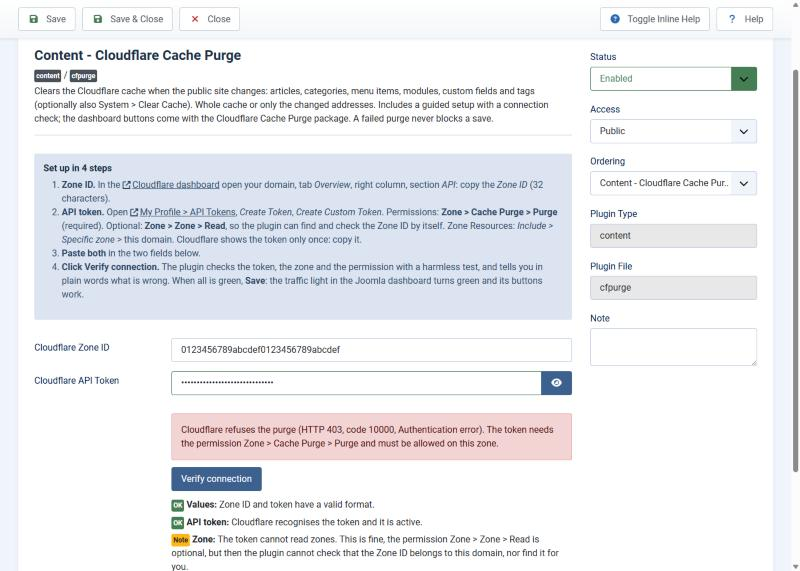
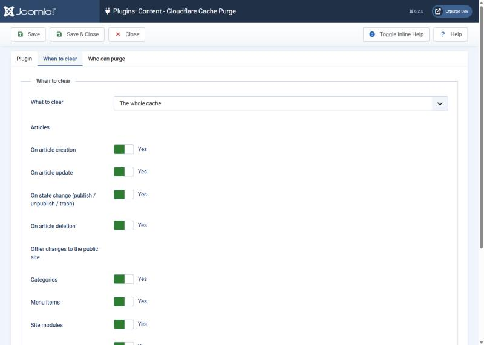

# Cloudflare Cache Purge: guida per l'operatore

Per chi gestisce il sito Joomla. Tutto da amministrazione di Joomla: niente codice, niente riga di
comando. Per gli sviluppatori: [DEVELOPING.md](./DEVELOPING.md). Versione inglese:
[USAGE.md](./USAGE.md).

In una riga: quando il sito cambia, **la cache di Cloudflare si svuota da sola**, e un riquadro
nella home dell'amministrazione permette di svuotarla **a mano**, tutta o solo alcune pagine.

## 1. Cosa ottieni

- **Purge automatico** quando crei, modifichi, pubblichi, spubblichi, cestini o cancelli un
  articolo, e anche quando cambi una categoria, una voce di menu, un modulo del sito, un campo
  personalizzato o un tag. Ogni tipo di modifica ha il suo interruttore.
- **Riquadro nella home** (pannello di controllo): semaforo della connessione a Cloudflare,
  pulsante *Svuota tutta la cache*, un campo per svuotare uno o più indirizzi e l'esito
  dell'ultimo purge.
- **Configurazione guidata** con il pulsante *Verifica connessione*, che ti dice in chiaro cosa non
  va (token, permesso, Zone ID).
- Facoltativi: svuotare Cloudflare **insieme a Sistema > Svuota cache**, e una **modalità
  mirata** che svuota solo le pagine cambiate invece di tutta la cache.

Requisiti: Joomla 5 o 6, PHP 8.1 o successivo, un account Cloudflare con il tuo dominio dentro.
Provato su Joomla 6.2.0 e 5.4.10 con PHP 8.4.

## 2. Installare

*Sistema > Installa > Estensioni > Carica file pacchetto*, trascina `pkg_cfpurge-2.0.0.zip` (dalle
[release](https://github.com/WebG-it/joomla-extensions/releases)). L'installazione accende tutto e
mette il riquadro nella home.

**Se hai il vecchio plugin (1.1.4 o precedente)**: installa il pacchetto sopra, oppure usa
*Sistema > Aggiorna > Estensioni*. È un aggiornamento sul posto: Zone ID, token e interruttori
restano. Apri una volta le opzioni del plugin e clicca **Verifica connessione** (passo 4): i
pulsanti del riquadro restano spenti finché la connessione salvata non è verificata.

## 3. Cloudflare: Zone ID e token

Al plugin servono due cose di Cloudflare. Le spiega anche il plugin, in cima alle sue opzioni.

**Zone ID**
1. Apri la [dashboard di Cloudflare](https://dash.cloudflare.com) e clicca il tuo dominio.
2. Nella pagina **Panoramica** (Overview), colonna di destra, sezione **API**, copia lo **Zone ID**
   (32 caratteri).

**API token** (solo il permesso che serve)
1. In alto a destra, profilo > **My Profile** (Il mio profilo) > **API Tokens** > **Create Token** >
   **Create Custom Token**.
2. Dagli un nome, per esempio `joomla-cache-purge-tuodominio`.
3. Permessi (nella pagina di Cloudflare si scelgono con questi nomi): **Zone > Cache Purge >
   Purge** (obbligatorio). Facoltativo: **Zone > Zone > Read**: con questo il plugin trova da solo lo
   Zone ID e controlla che sia quello di questo sito.
4. Zone Resources: **Include > Specific zone** > il tuo dominio.
5. **Create Token** e copialo: Cloudflare lo mostra una sola volta.

## 4. Configurare il plugin

*Sistema > Plugin*, apri **Contenuto - Cloudflare Cache Purge**. La scheda **Configurazione**
comincia con i quattro passi. Incolla Zone ID e token (lo Zone ID si può lasciare vuoto se il token
ha Zone Read) e clicca **Verifica connessione**.

Controlla il formato, chiede a Cloudflare se il token è attivo, trova o controlla la zona e invia
un **purge di prova innocuo** (per un indirizzo che non esiste) per dimostrare che il token può
svuotare questa zona. Se qualcosa non va dice cosa e che cosa fare (qui la versione in inglese del
caso "il token non ha il permesso di purge"):

Quando è tutto verde clicca **Salva**: il semaforo nella home diventa verde.

## 5. Il riquadro nella home

| Stato | Significato |
|---|---|
| **Non configurato** (grigio) | Manca lo Zone ID o il token. |
| **Non verificato** (giallo) | Sono inseriti ma la connessione non è stata verificata (o li hai cambiati dopo). I pulsanti di svuotamento sono spenti. |
| **Non funziona** (rosso) | L'ultima verifica è fallita. Apri le impostazioni e clicca *Verifica connessione*. |
| **Collegato** (verde) | Verificato. |
| **Controlla l'ultimo purge** (giallo) | Verificato, ma l'ultimo purge è fallito: vedi la riga in fondo. |
| **Plugin spento** (grigio) | Il plugin di contenuto è disabilitato in *Sistema > Plugin*. |

- **Svuota tutta la cache**: chiede conferma, poi svuota tutto.
- **Svuota solo questi indirizzi**: uno per riga, un percorso (`/mia-pagina`) oppure un indirizzo
  completo del sito. Gli indirizzi di altri siti vengono rifiutati. Al massimo 100 per volta.
- **Ultimo purge**: quando, chi, cosa, perché (un articolo salvato, il pulsante della home, ...) e
  se Cloudflare ha confermato.

Chi vede il riquadro: i **Super Utenti** e i gruppi di utenti scelti nelle opzioni (predefiniti
Amministratore e Super Utenti). Gli altri utenti del backend non lo vedono, e il server rifiuta le
loro richieste anche se le costruiscono a mano.

## 6. Opzioni

Scheda **Quando svuotare**:

- **Cosa svuotare**: *Tutta la cache* (predefinito, la scelta più sicura) oppure *Solo gli
  indirizzi cambiati*. Nella modalità mirata un articolo svuota la propria pagina, le pagine della
  sua categoria e delle categorie sopra, la home e gli **indirizzi fissi aggiuntivi** che elenchi
  (per esempio `/sitemap.xml`, `/feed`); se un articolo viene rinominato o spostato si svuota anche
  il suo vecchio indirizzo. Gli elenchi che mostrano l'articolo altrove (moduli laterali, ricerca,
  pagine successive, tag, home di altre lingue) **non** vengono svuotati e restano finché Cloudflare
  non li fa scadere: se serve, usa tutta la cache. Tutto ciò che non è un articolo, e ogni caso in
  cui gli indirizzi non si riescono a calcolare, svuota tutta la cache.
- **Articoli**: alla creazione, modifica, cambio di stato, cancellazione (interruttori, tutti
  accesi di default).
- **Altre modifiche al sito pubblico**: categorie, voci di menu, moduli del sito, campi
  personalizzati e tag (accesi di default, svuotano sempre tutta la cache).
- **Svuota anche Cloudflare quando svuoto la cache di Joomla**: *Sistema > Svuota cache*, pulsanti
  *Elimina* ed *Elimina tutto* (non *Elimina scaduti*). Spento di default.

Scheda **Chi può svuotare**: i gruppi di utenti che vedono il riquadro e ne usano i pulsanti (i
Super Utenti possono sempre). Il purge automatico non dipende da questa scelta.

## 7. Da sapere

- **Il purge non blocca mai un salvataggio.** Se Cloudflare rifiuta o non risponde l'articolo
  viene salvato lo stesso; il problema resta nel log e nel riquadro. La chiamata a Cloudflare
  scade dopo 8 secondi.
- **Più modifiche nella stessa richiesta sono una sola chiamata** (la pubblicazione di 50 articoli
  in blocco). Cloudflare accetta 30 indirizzi per chiamata: gli altri vanno a blocchi, sopra i 90
  si svuota tutta la cache.
- **Il log** è `administrator/logs/plg_content_cfpurge.php`: una riga per purge o verifica, senza
  token e senza Zone ID, ruotato sopra 1 MB.
- **Il token** sta nelle opzioni del plugin, come nelle versioni vecchie, e viene inviato solo a
  `api.cloudflare.com`.
- Le modifiche fatte direttamente nel database (non da Joomla) non fanno scattare gli eventi: usa
  il riquadro.
- Un articolo che diventa visibile **da solo** alla data di *Inizio pubblicazione* (o sparisce a
  *Fine pubblicazione*) non fa scattare nessun evento: svuota a mano, oppure tieni tempi di cache
  brevi in Cloudflare per le pagine con pubblicazione programmata.

## 8. Aggiornare e disinstallare

Gli aggiornamenti compaiono in *Sistema > Aggiorna > Estensioni* (il pacchetto registra il server di
aggiornamento WebG).

*Sistema > Gestisci > Estensioni*, cerca **Cloudflare Cache Purge**, seleziona il **pacchetto** e
**Disinstalla**. Va via tutto: i plugin, il modulo e il suo posto nella home, i file di lingua, il
log e il server di aggiornamento. Non ci sono tabelle nel database.

## 9. Se qualcosa non va

| Cosa vedi | Cosa fare |
|---|---|
| *L'API token è vuoto / non sembra corretto* | Incolla di nuovo solo il token (senza spazi e senza la parola Bearer). |
| *Cloudflare rifiuta il purge (HTTP 403, code 10000)* | Al token manca **Zone > Cache Purge > Purge**, oppure non è abilitato su questa zona. Crea un token nuovo come al passo 3. |
| *Cloudflare non conosce questo Zone ID* | Copialo di nuovo dalla pagina Panoramica del dominio. |
| *Questo Zone ID appartiene alla zona X, che non copre questo sito* | Hai incollato lo Zone ID di un altro dominio: usa quello proposto. |
| *Da questo server non si raggiunge Cloudflare* | L'hosting blocca le chiamate HTTPS in uscita verso `api.cloudflare.com`. |
| Il riquadro non è nella home | Non sei in un gruppo ammesso, oppure il modulo è stato spubblicato: *Sistema > Moduli amministratore*, *Cloudflare Cache Purge*, posizione `cpanel`. |
| Una modifica non viene svuotata | Controlla che il plugin (e, per i moduli e *Svuota cache*, il plugin di sistema) sia abilitato, che l'interruttore di quel tipo di modifica sia acceso, e leggi il log. |

## Compatibilità provata

Joomla 6.2.0 e 5.4.10, PHP 8.4, MariaDB 11.4: installazione, aggiornamento sopra la 1.1.4,
aggiornamento dal server di aggiornamento, purge dal riquadro, verifica con token e zone sbagliati,
tutti gli eventi, indirizzi mirati, disinstallazione. Cloudflare era un'API finta (nessun token
vero nelle prove). JED Checker `master` e `develop`: zero errori, zero avvisi.

Supporto: [GitHub issues](https://github.com/WebG-it/joomla-extensions/issues) (scrivi le versioni
di Joomla e PHP; mai token o dati privati nei messaggi).
